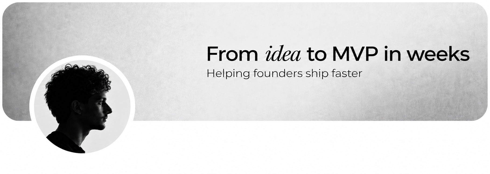

 

# Hey, I’m Yasser 👋

**Independent senior software engineer working with startups.**

I help founders turn ideas into products—from early MVPs to software that scales. I work across AI, SaaS, web, and mobile, bringing hands-on engineering and product thinking to every project.

I care about shipping quickly, keeping code maintainable, and building things people enjoy using.

### Selected work

- [Currai](https://currai.app/) — AI observability.
- [Dubchat](https://dub.chat/) — Real-time voice translation.
- [Oncyber](https://oncyber.com/) — Immersive virtual worlds.
- [AWE](https://awe.box/) — Virtual experiences.
- [Skineat AI](https://skineat.app/) — AI food scanning.

### Let’s work together

Building something new or growing an existing product? Let’s talk.

[Portfolio](https://ameurio.me/) · [Book a call](https://cal.com/ameurio/15min) · [Email](mailto:yasser@ameurio.me)
